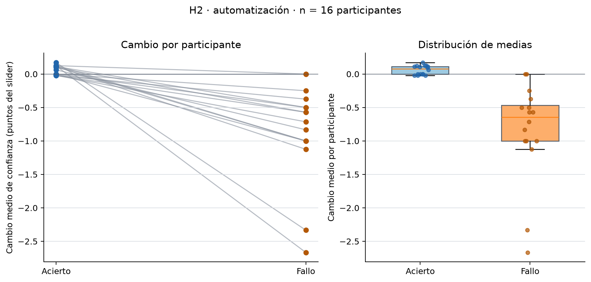

# H2 — Cambio de confianza tras aciertos y fallos de la automatización

## Datos y definición

Fuente: `ATC_EXTRACTOR/datos_combinados.xlsx` (hoja `TRIALS`, 1209 filas; 16 participantes con deltas válidos). Se usó el libro consolidado existente; `ATC_EXTRACTOR/unir_excel.py` es el proceso del repo que apila los Excel individuales. No se encontró en el repo otra convención o análisis previo de H2 ni material CRID o plantilla de informe; para recomendar prueba se aplica la regla estándar de Shapiro–Wilk con α = 0,05. La variable principal es `automation_error`: 0 = acierto de la automatización; 1 = fallo. `correct` describe el desempeño del participante y no define H2; no se hizo análisis de sensibilidad con `correct` al no encontrarse una convención alternativa que genere ambigüedad.

Se excluyeron el bloque manual 1 y los bloques fuera del intervalo automatizado 2–5 (incluido el bloque 6 que aparece en algunos archivos, porque no forma parte de los cuatro bloques descritos para el experimento). Se descartaron pares de ensayos con `answer = no_response`, `trust` o `automation_error` ausente, o con números de trial no consecutivos. Se requieren dos respuestas de confianza válidas para calcular cada cambio.

**Convención temporal:** para el trial consecutivo t, `delta_trust = trust_t − trust_(t−1)` y el cambio se clasifica con `automation_error_t`, el resultado del trial t, después del cual se registró `trust_t`. El emparejamiento se hace dentro de cada participante, sesión, fase y bloque; nunca cruza límites de bloque.

En los bloques automatizados había 1024 filas: 42 con `no_response`, 50 sin confianza y 50 sin `automation_error`. Se conservaron 746 deltas válidos, incluidos 88 tras fallos. Para la prueba pareada global se incluyeron 16 participantes; 0 no tenían ambas condiciones y se excluyeron de la comparación pareada.

## Descriptivos de cambios por ensayo

| Resultado de automatización | N deltas | Media | DE | Mediana | Q1 | Q3 | IQR |
|---|---:|---:|---:|---:|---:|---:|---:|
| Acierto | 658 | 0.058 | 0.730 | 0.000 | 0.000 | 0.000 | 0.000 |
| Fallo | 88 | -0.727 | 1.239 | 0.000 | -1.000 | 0.000 | 1.000 |

## Comparación pareada por participante

Las medias se calcularon por participante y condición agrupando fases y bloques automatizados. La diferencia se definió como media tras acierto menos media tras fallo.

| Medida | Resultado |
|---|---:|
| N participantes pareables | 16 |
| Media del delta tras acierto (DE) | 0.061 (0.067) |
| Media del delta tras fallo (DE) | -0.840 (0.734) |
| Diferencia por participante (media; DE) | 0.901; 0.773 |
| Diferencia por participante (mediana; IQR) | 0.680; 0.651 |
| Shapiro–Wilk de las diferencias | W = 0.840; p = 0,010 |
| t de Student pareada | t(15) = 4.663; p < 0,001 |
| IC 95 % de la diferencia | [0.489, 1.312] |
| Cohen dz | 1.166 |
| Wilcoxon de rangos signados | W = 0.000; p < 0,001 |
| Correlación rank-biserial emparejada | 1.000 |
| Prueba recomendada por Shapiro–Wilk | Wilcoxon (no paramétrico; Shapiro-Wilk p < 0,05) |

**Interpretación:** Se incluyeron 16 participantes con ambas condiciones. La diferencia media por participante (acierto − fallo) fue 0.901 (DE = 0.773; IC 95 % [0.489, 1.312]). La t pareada dio t(15) = 4.663, p < 0,001, dz = 1.166; Wilcoxon W = 0.000, p < 0,001, rrb = 1.000. Shapiro–Wilk: W = 0.840, p = 0,010. Según el criterio de normalidad (α = 0,05), se recomienda como prueba principal: **Wilcoxon (no paramétrico; Shapiro-Wilk p < 0,05)**. En promedio, la confianza descendió tras fallos, mientras que tras aciertos permaneció prácticamente estable; por tanto, los datos respaldan que el cambio es más positivo tras un acierto que tras un fallo, pero no muestran un aumento claro tras aciertos. Los 88 deltas válidos tras fallos ocurrieron en el bloque 4 (0 en otros bloques); como los aciertos también proceden de los bloques 2, 3 y 5, el contraste global está parcialmente confundido con el bloque. La comparación exploratoria dentro del bloque 4 también muestra mayor cambio tras acierto que tras fallo.

## Exploratorio por fase y bloque

Las comparaciones por celda son exploratorias; los valores p no se ajustaron por comparaciones múltiples.

| Fase | Bloque | Pares | Δ tras acierto (media) | Δ tras fallo (media) | Diferencia media | t | p t | W | p Wilcoxon |
|---|---:|---:|---:|---:|---:|---:|---:|---:|---:|
| ECOLOGICAL | 2 | 0 | — | — | — | — | — | — | — |
| ECOLOGICAL | 3 | 0 | — | — | — | — | — | — | — |
| ECOLOGICAL | 4 | 15 | 0.433 | -0.856 | 1.289 | 3.855 | = 0,002 | 0.000 | = 0,001 |
| ECOLOGICAL | 5 | 0 | — | — | — | — | — | — | — |
| NEUTRAL | 2 | 0 | — | — | — | — | — | — | — |
| NEUTRAL | 3 | 0 | — | — | — | — | — | — | — |
| NEUTRAL | 4 | 11 | 0.318 | -0.855 | 1.173 | 2.268 | = 0,047 | 0.000 | = 0,004 |
| NEUTRAL | 5 | 0 | — | — | — | — | — | — | — |

## Figuras

## Archivos de apoyo

- `h2_results.xlsx`: resultados tabulares en las hojas `informe`, `contraste_global`, `descriptivos_delta`, `participantes`, `fase_bloque`, `participantes_fase_bloque`, `deltas_trial` y `control_calidad`.
