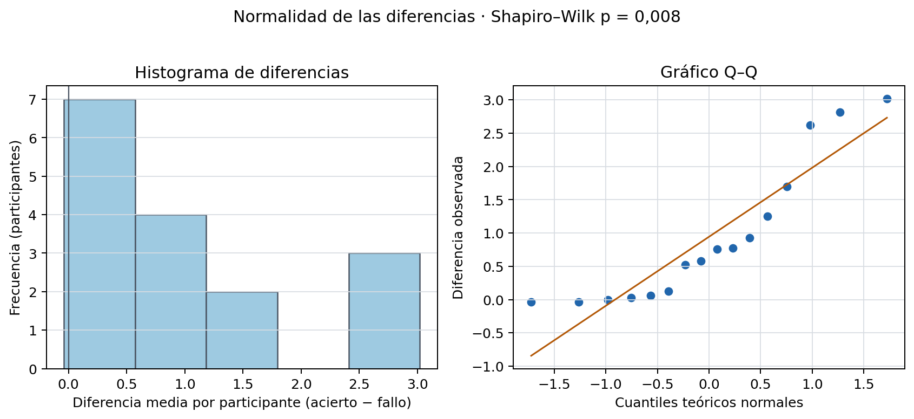

# H2 — Cambio de confianza tras respuestas correctas e incorrectas

## Datos y definición

Fuente: `ATC_EXTRACTOR/datos_combinados.xlsx` (hoja `TRIALS`, 1209 filas; 16 participantes con deltas válidos). Se usó el libro consolidado existente; `ATC_EXTRACTOR/unir_excel.py` es el proceso del repo que apila los Excel individuales. No se encontró en el repo otra convención o análisis previo de H2 ni material CRID o plantilla de informe; para recomendar prueba se aplica la regla estándar de Shapiro–Wilk con α = 0,05. La variable principal es `correct`: 1 = respuesta del participante correcta; 0 = incorrecta. `automation_error` se presenta aparte y mide si la sugerencia automática fue errónea.

Se excluyeron el bloque manual 1 y los bloques fuera del intervalo automatizado 2–5 (incluido el bloque 6 que aparece en algunos archivos, porque no forma parte de los cuatro bloques descritos para el experimento). Se descartaron pares de ensayos con `answer = no_response`, `trust`, `correct` o `automation_error` ausente, o con números de trial no consecutivos. Se requieren dos respuestas de confianza válidas para calcular cada cambio.

**Convención temporal:** para el trial consecutivo t, `delta_trust = trust_t − trust_(t−1)` y el análisis principal se clasifica con `correct_t`, la respuesta del participante en el ensayo t, después del cual se registró `trust_t`. El análisis complementario se clasifica con `automation_error_t`. El emparejamiento se hace dentro de cada participante, sesión, fase y bloque; nunca cruza límites de bloque.

En los bloques automatizados había 1024 filas: 42 con `no_response`, 50 sin confianza, 0 sin `correct` y 50 sin `automation_error`. Se conservaron 746 deltas válidos, incluidos 57 tras una respuesta incorrecta. Para la prueba pareada global se incluyeron 16 participantes; 0 no tenían ambas condiciones y se excluyeron de la comparación pareada.

## Descriptivos de cambios por ensayo

| Resultado de la respuesta del participante | N deltas | Media | DE | Mediana | Q1 | Q3 | IQR |
|---|---:|---:|---:|---:|---:|---:|---:|
| Acierto | 689 | 0.023 | 0.768 | 0.000 | 0.000 | 0.000 | 0.000 |
| Fallo | 57 | -0.737 | 1.303 | 0.000 | -1.000 | 0.000 | 1.000 |

## Comparación pareada por participante

Las medias se calcularon por participante y condición agrupando fases y bloques automatizados. La diferencia se definió como media tras acierto menos media tras fallo.

| Medida | Resultado |
|---|---:|
| N participantes pareables | 16 |
| Media del delta tras acierto (DE) | 0.028 (0.068) |
| Media del delta tras fallo (DE) | -0.916 (1.024) |
| Diferencia por participante (media; DE) | 0.944; 1.057 |
| Diferencia por participante (mediana; IQR) | 0.670; 1.310 |
| Shapiro–Wilk de las diferencias | W = 0.834; p = 0,008 |
| t de Student pareada | t(15) = 3.573; p = 0,003 |
| IC 95 % de la diferencia | [0.381, 1.507] |
| Cohen dz | 0.893 |
| Wilcoxon de rangos signados | W = 5.000; p = 0,002 |
| Correlación rank-biserial emparejada | 0.917 |
| Prueba recomendada por Shapiro–Wilk | Wilcoxon (no paramétrico; Shapiro-Wilk p < 0,05) |

**Interpretación:** Se incluyeron 16 participantes con ambas condiciones. La diferencia media por participante (acierto − fallo) fue 0.944 (DE = 1.057; IC 95 % [0.381, 1.507]). La t pareada dio t(15) = 3.573, p = 0,003, dz = 0.893; Wilcoxon W = 5.000, p = 0,002, rrb = 0.917. Shapiro–Wilk: W = 0.834, p = 0,008. Según el criterio de normalidad (α = 0,05), se recomienda como prueba principal: **Wilcoxon (no paramétrico; Shapiro-Wilk p < 0,05)**. En promedio, la confianza descendió tras respuestas incorrectas y permaneció prácticamente estable tras respuestas correctas; por tanto, los datos respaldan que el cambio es más positivo tras un acierto que tras un fallo, pero no muestran un aumento claro tras los aciertos.

## Análisis complementario con `automation_error`

Este análisis responde a otra pregunta: cómo cambia la confianza tras una sugerencia automática correcta o errónea. Con `automation_error`, la diferencia media acierto − fallo fue 0.901 puntos (n = 16; t(15) = 4.663, p < 0,001; Wilcoxon p < 0,001). Hubo 88 deltas tras una sugerencia errónea, 0 fuera del bloque 4. La tabla por fase y bloque para esta variable también se guarda en el libro Excel.

## Exploratorio por fase y bloque

Las comparaciones por celda son exploratorias; los valores p no se ajustaron por comparaciones múltiples.

| Fase | Bloque | Pares | Δ tras acierto (media) | Δ tras fallo (media) | Diferencia media | t | p t | W | p Wilcoxon |
|---|---:|---:|---:|---:|---:|---:|---:|---:|---:|
| ECOLOGICAL | 2 | 0 | — | — | — | — | — | — | — |
| ECOLOGICAL | 3 | 5 | 0.150 | -0.800 | 0.950 | 1.205 | = 0,295 | 2.000 | = 0,500 |
| ECOLOGICAL | 4 | 12 | -0.153 | -0.958 | 0.806 | 1.795 | = 0,100 | 12.500 | = 0,141 |
| ECOLOGICAL | 5 | 7 | 0.310 | -0.714 | 1.024 | 1.904 | = 0,106 | 1.000 | = 0,125 |
| NEUTRAL | 2 | 0 | — | — | — | — | — | — | — |
| NEUTRAL | 3 | 3 | 0.139 | -1.000 | 1.139 | 1.123 | = 0,378 | 0.000 | = 0,250 |
| NEUTRAL | 4 | 10 | -0.146 | -0.833 | 0.687 | 1.849 | = 0,098 | 8.000 | = 0,195 |
| NEUTRAL | 5 | 5 | 0.100 | -0.400 | 0.500 | 1.737 | = 0,157 | 1.000 | = 0,250 |

## Figuras

## Archivos de apoyo

- `h2_results.xlsx`: resultados principales tabulares en hojas que usan `correct` y análisis complementarios de `automation_error` en las hojas `sens_*`.
